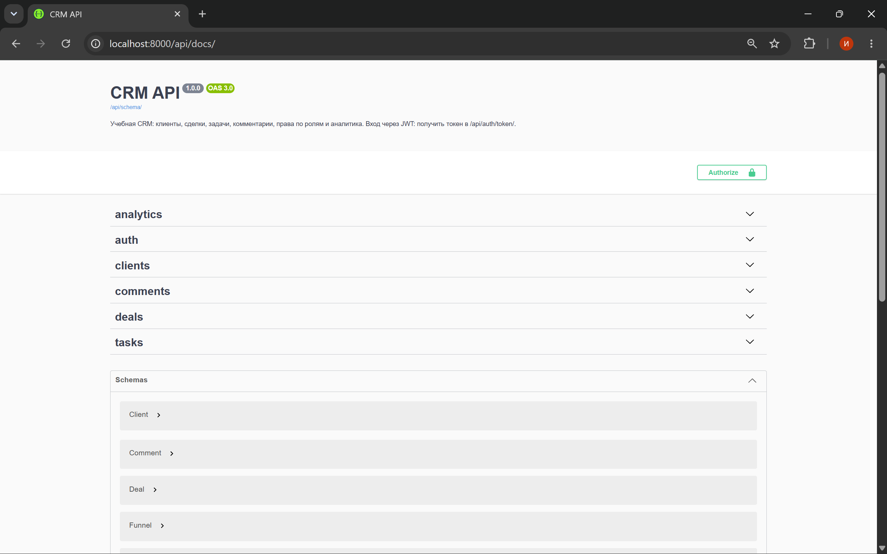
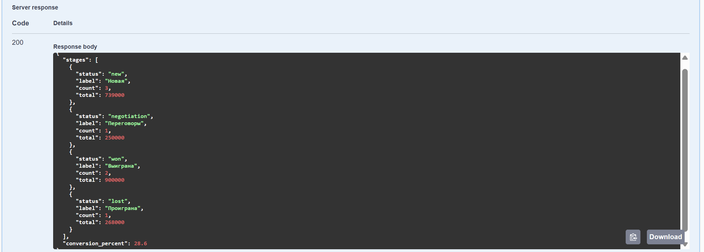
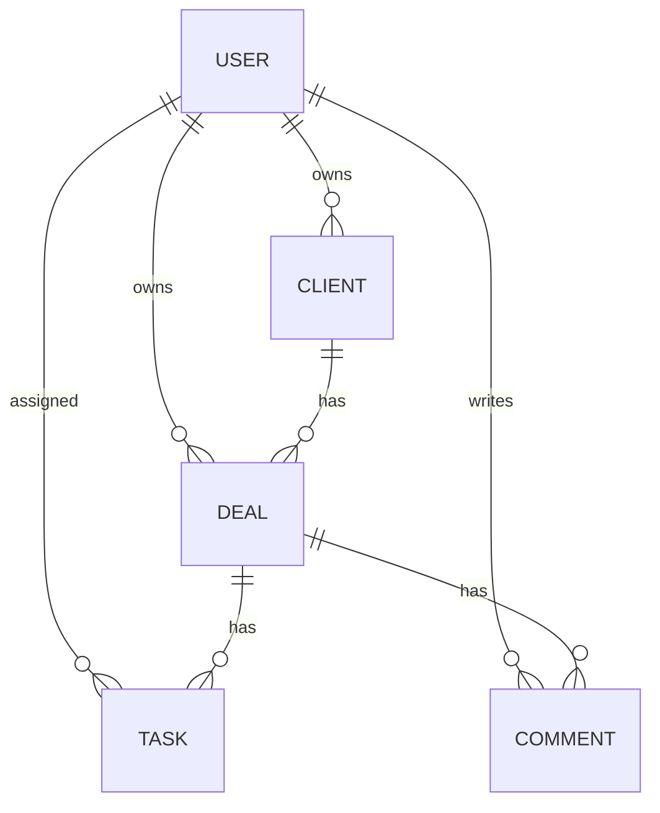

# CRM API


Учебный проект: небольшая CRM для менеджеров по продажам. Менеджер ведёт клиентов,
сделки и задачи и видит только свои данные, а администратор видит всё.
Тема, выбрана для изучения Django REST Framework, Docker и тесты.

**Документация API:** `/api/docs/` (Swagger UI)



## Стек

Python 3.12, Django, Django REST Framework, PostgreSQL, Redis, Celery,
Docker Compose, pytest, ruff.

## Запуск

Нужны Docker и Docker Compose.

```bash
cp .env.example .env
docker compose up -d --build
docker compose exec web python manage.py migrate
docker compose exec web python manage.py seed_demo
```

Документация откроется на <http://localhost:8000/api/docs/>.

Демо-пользователи (пароль `demo12345`): `demo_boss` (админ),
`demo_anna` и `demo_igor` (менеджеры).

Чтобы попробовать API, получи токен в `/api/auth/token/` под одним из них,
нажми **Authorize** в Swagger и вставь значение `access`.

## Что умеет

1. Менеджер видит и меняет только свои клиенты, сделки и задачи, чужие записи отвечают 404
2. Владелец и автор записи берутся из токена, а не из тела запроса
3. Воронка по статусам с конверсией и выручка по менеджерам
4. Celery напоминает о просроченных задачах и раз в день пишет отчёт по сделкам
5. Демо-данные создаются одной командой, на права и отчёты есть тесты



Воронка менеджера на демо-данных: 7 сделок, конверсия 28.6%.

## Схема данных



## Решения, которые я принимал

1. **`PROTECT` вместо `CASCADE` для клиентов и сделок.** Если удалить менеджера или
   клиента, вместе с ним пропали бы сделки и деньги. С `PROTECT` Django не даёт
   удалить, пока есть связанные записи. Каскад оставил только для задач и
   комментариев без сделки они не нужны.
2. **404 вместо 403 для чужих записей.** Если менеджер просит чужую сделку, ответ
   «не найдено». Иначе по ответам можно было бы перебирать номера и узнавать,
   что у других есть сделки.
3. **Правила видимости в одном месте.** Сначала они были записаны и во view, и в
   отчётах. Я вынес их в `selectors.py`, чтобы при изменении правил не искать копии
   по проекту.

## Для дальнейшего улучшил

- Проверку, что сумма сделки больше нуля: сейчас через API можно создать сделку
  с отрицательной суммой.
- Развернуть проект на хостинге и добавить ссылку.
- Настроить проверки на GitHub (линтер и тесты на каждый коммит).

## Тесты

```bash
docker compose exec web pytest
ruff check . && ruff format --check .
```

## Структура

```
apps/users     пользователь и роли
apps/clients   клиенты
apps/deals     сделки, задачи, комментарии, аналитика, Celery-задачи
config         настройки, urls, Celery
tests          pytest
docs/img       скриншоты для README
```
